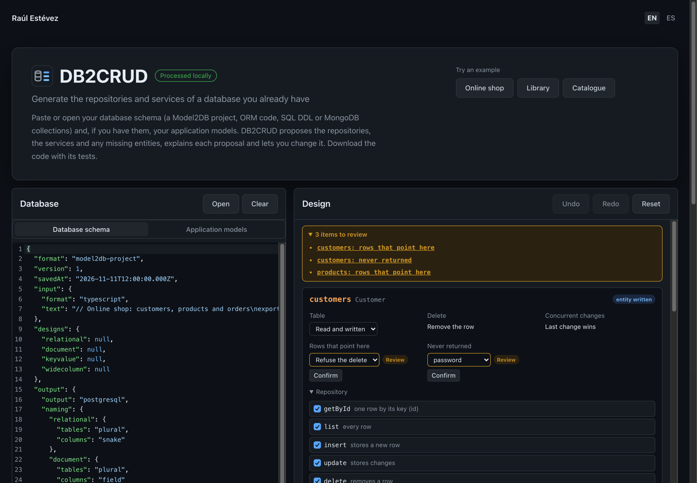

# DB2CRUD

Client-side tool that generates the data access layer of a database that already exists: entities (when they are missing), repositories and services, linked to your application models, **without sending anything to a server**.

**Try it online:** [raulesteveza.github.io/tools/DB2CRUD](https://raulesteveza.github.io/tools/DB2CRUD/)

- 🇬🇧 **English:** [Full documentation](./README_en.md)
- 🇪🇸 **Español:** [Documentación completa](./README_es.md)

  

## What is this repository?

DB2CRUD starts from a database you already have: a Model2DB project, ORM code, SQL DDL or MongoDB collections, and, if you have them, the models of your application. It proposes the repositories with the queries the schema allows, the services that convert between models and entities, validate and report domain errors, and the entities that are missing. It writes Python, TypeScript, Java, C#, PHP, Kotlin, Rust and Swift (the last three are experimental), with an ORM, without one (SQL) or for MongoDB.

It proposes, but never decides an ambiguity: decisions to review wait for the user, and the generated code leaves a `TODO` where each one goes.

There are two versions, checked by shared test cases:

- **Web**: React + TypeScript, in the browser: [raulesteveza.github.io/tools/DB2CRUD](https://raulesteveza.github.io/tools/DB2CRUD/).
- **Desktop**: Python + PySide6, with the same features, for Windows, macOS and Linux: [download](./desktop/README_en.md#download).

It continues the chain [Api2Class](https://github.com/RaulEstevezA/Api2Class) → [Mapper](https://github.com/RaulEstevezA/Mapper) → [Model2DB](https://github.com/RaulEstevezA/Model2DB), and works on its own as well.

## Suggestions

Ideas for improvements, bugs or a library you would like DB2CRUD to write for: write to [contact.raulesteveza@gmail.com](mailto:contact.raulesteveza@gmail.com).

## Developer

**Raul Estevez**

- [Personal Website](https://raulesteveza.github.io/)
- [LinkedIn Profile](https://www.linkedin.com/in/raulesteveza/)

## License

[MIT](./LICENSE)
